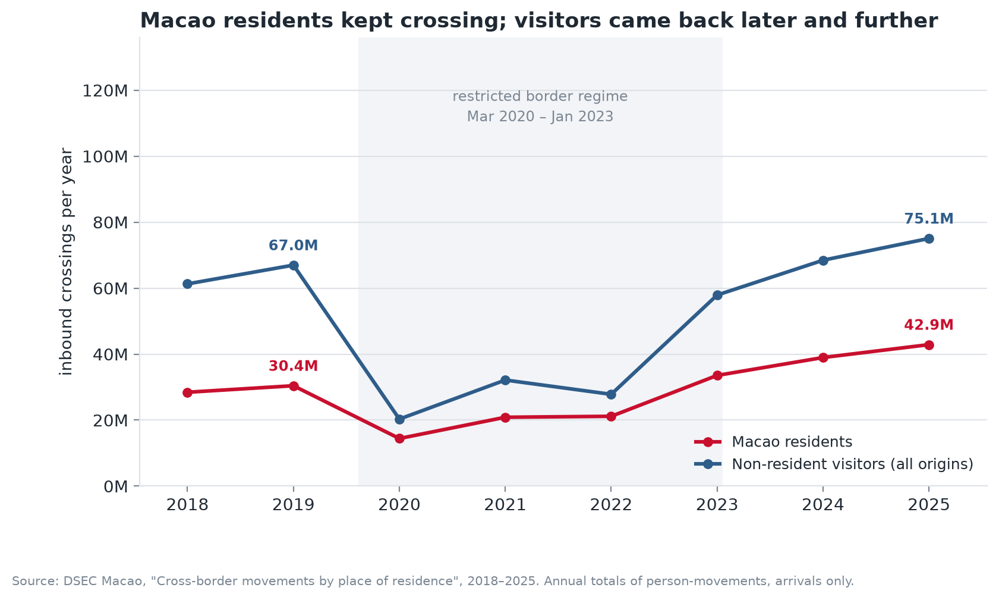
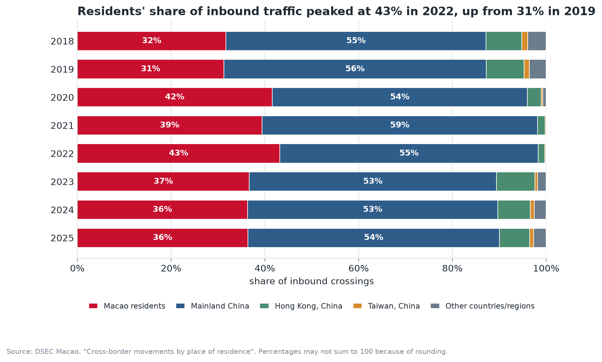
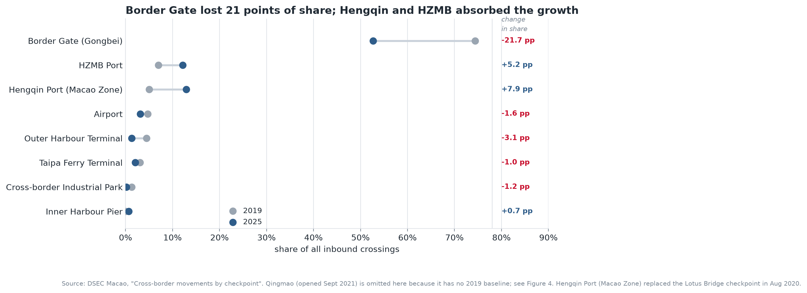
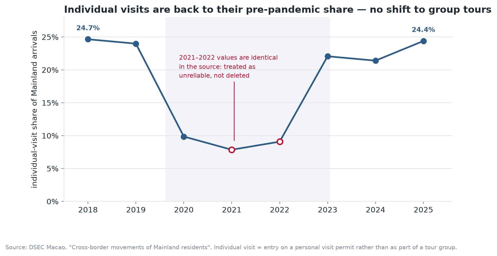

# Has Macao's border reopened — or been rebuilt?

**A structural analysis of cross-border movements through Macao's checkpoints, 2018–2025**



---

## 1. The problem

Macao is a city of roughly 690,000 residents that recorded **117.9 million inbound border crossings in
2025** — more than any year before the pandemic. Headlines read "tourism fully recovered". But a
recovered total can hide a completely different structure underneath it.

This project asks:

> **Did Macao's cross-border system return to its pre-pandemic shape, or did the pandemic permanently
> reallocate traffic between checkpoints and between types of traveller?**

The question matters for transport planning, retail site selection and tourism marketing: if the
recovery is carried by different gateways and different travellers than in 2019, then capacity,
marketing and policy decisions based on 2019 patterns will be aimed at the wrong places.

Three sub-questions structure the analysis:

1. Who is crossing the boundary now, compared with 2019?
2. Which checkpoints absorbed the growth, and which lost ground?
3. Did the *type* of Mainland visitor change (group tour vs individual visit)?

---

## 2. Dataset and usage permissions

| | |
|---|---|
| **Publisher** | Statistics and Census Service (DSEC) of the Macao SAR |
| **Platform** | Macao Government Open Data Platform — <https://data.gov.mo> |
| **Datasets** | 各地居民出入境人數 · 各入境事務站出入境人數 · 中國居民出入境人數 (portal record `3546225a-2a34-4645-b01e-6752aed03993`) |
| **Licence** | **完全開放 / Fully open** — free to use, reuse and redistribute, including commercially, with attribution |
| **Permission check** | No registration, API key or personal data involved; the portal classifies these as fully open datasets |
| **Granularity** | Annual, 2018–2025 |
| **Unit** | One *movement* across the boundary (persons, not unique individuals) |
| **Privacy** | Aggregate published statistics only; nothing individual-level, no personal data |
| **Retrieved** | October 2026 |

The three workbooks are committed unmodified under [`data/raw/`](data/raw/) so the analysis is
reproducible without network access. Original Chinese filenames map to the files as follows:

| Original filename | Committed as |
|---|---|
| `各地居民出入境人數.xlsx` | `dsec_crossborder_by_resident_2018_2025.xlsx` |
| `各入境事務站出入境人數.xlsx` | `dsec_crossborder_by_checkpoint_2018_2025.xlsx` |
| `中國居民出入境人數.xlsx` | `dsec_crossborder_mainland_visits_2018_2025.xlsx` |

**Important semantic note.** These tables count *person-movements*, not people. A resident who commutes
daily contributes several hundred crossings a year; a three-night tourist contributes two. Every figure
in this project is therefore a flow, and flows cannot be converted into headcounts.

---

## 3. Methods and tools

**Stack.** Python 3.13 · pandas · NumPy · Matplotlib · Jupyter. No dashboard framework, no external
services — the whole pipeline runs from the committed Excel files.

**Pipeline** (`notebooks/macao_border_crossings.ipynb`):

1. **Load** three workbooks and strip the trailing space in the `year ` header.
2. **Resolve a mid-series schema change.** Up to 2021 each table reports one row per
   (origin, direction); from 2022 the row is replaced by two rows split by gender. A naive
   `groupby` silently drops four years. Fixed by summing over gender to a single
   (year, dimension, direction) grain.
3. **Harmonise checkpoint names.** Every station gained the suffix 「出入境事務站」 in 2021, and the
   Lotus Bridge checkpoint was superseded by the Hengqin Port Macao Zone in August 2020. A 14-entry
   lookup table maps both naming eras onto one canonical label — without it, a timeline would show two
   unrelated series instead of one continuing corridor.
4. **Validate.** The origin table and the checkpoint table describe the same population; their annual
   totals are asserted to reconcile to the unit. All eight years match exactly.
5. **Analyse** the origin mix, the checkpoint mix, absolute reallocation and the Mainland
   individual-visit share.
6. **Export** two tidy CSVs at a stable (year, dimension, direction) grain to `data/processed/`.

**Visual design choices.** Five charts, each answering one sub-question. Direct labelling replaces
legends where a series is self-evident; the 2020–2022 restricted-border period is shaded rather than
drawn as a separate category; the diverging bar chart uses a warm hue for losses and a cool hue for
gains so the two directions differ in hue *and* luminance (legible under the common forms of colour
vision deficiency); values are always shown in millions with the unit in the axis title.

---

## 4. Key findings

### 4.1 The record total is produced by residents, not tourists



Inbound crossings in 2025 were **+21 % above 2019** — but the two halves of the flow behaved very
differently:

* **Macao residents: +41 %** against 2019 (30.4 M → 42.9 M).
* **Non-resident visitors: +12 %** (67.0 M → 75.1 M), and they did not pass their 2019 level until 2024.

Residents' share of inbound traffic rose from **31.2 % in 2019** to a **43.2 % peak in 2022**, settling at
**36.4 % in 2025** — still four to five points above pre-pandemic. The border is busier than before,
but a larger share of that traffic is local mobility.

### 4.2 One gateway became four




Border Gate (Gongbei) carried **74.4 %** of inbound crossings in 2019 and **52.7 %** in 2025 — a loss of
21.7 percentage points — even though its absolute volume only fell 14 %. The difference was taken by
land corridors:

| Checkpoint | 2019 | 2025 | Change |
|---|---:|---:|---:|
| Hengqin Port (Macao Zone) | 4.9 M | 15.2 M | **+10.3 M** |
| HZMB Port | 6.8 M | 14.3 M | **+7.5 M** |
| Qingmao | — | 17.6 M | **+17.6 M** (opened Sep 2021) |
| Border Gate (Gongbei) | 72.5 M | 62.2 M | −10.3 M |
| Outer Harbour Terminal | 4.4 M | 1.6 M | −2.8 M |
| Airport | 4.6 M | 3.7 M | −0.9 M |

**Sea and air gateways have not recovered.** Outer Harbour Terminal is at **36 %** of its 2019 volume,
Taipa at **82 %** and the airport at **80 %** — every non-land gateway is still below 2019, while all
four land checkpoints are above it. The recovery is land-based, which is
consistent with the tourist source market consolidating onto the Mainland: the Mainland's share of
visitor arrivals rose from 81.4 % to 84.3 % while Hong Kong's fell from 11.7 % to 10.1 %.

### 4.3 The composition of the Mainland market was resilient



Individual-visit travellers (個人遊) made up **24.7 %** of Mainland arrivals in 2018 and **24.4 %** in
2025 — statistically the same share. The pandemic interrupted both individual and group travel but did
not push the market towards packaged tours. A useful negative result: the *mix* of the Mainland market
proved more stable than its *volume*.

### 4.4 One limitation

The dataset counts **movements, not people, and only annually**. A daily cross-border commuter
contributes hundreds of crossings while a three-night tourist contributes two, so the growth in the
resident share **cannot** be converted into a statement about how many people crossed how often.
With no monthly breakdown and no purpose-of-travel field, the analysis can show *that* traffic was
reallocated between checkpoints, but cannot attribute that reallocation to commuting, shopping or
tourism with confidence. A monthly series, or an origin × checkpoint cross-tabulation, would be needed.

A second, smaller caveat: the Mainland individual-visit count is reported as **2,449,143 in both 2021
and 2022** — and the 2022 figure is exactly the sum of its own male and female components. Two
different years cannot plausibly share a seven-digit total, so those two points are flagged as a
probable publication artefact and excluded from any claim; they are annotated rather than deleted so
the reader can see the problem.

---

## 5. Running the analysis

```bash
# 1. clone
git clone https://github.com/<your-username>/data-science-project.git
cd data-science-project

# 2. environment (Python 3.10+)
python -m venv .venv
source .venv/bin/activate          # Windows: .venv\Scripts\activate
pip install -r requirements.txt

# 3. run
jupyter notebook notebooks/macao_border_crossings.ipynb
```

Running all cells regenerates the five PNGs in `figures/` and the two cleaned CSVs in
`data/processed/`. No network access is required — the raw workbooks are in the repository.

**Repository layout**

```
data-science-project/
├── data/
│   ├── raw/          # three DSEC workbooks, unmodified
│   └── processed/    # tidy CSVs written by the notebook
├── notebooks/
│   └── macao_border_crossings.ipynb
├── figures/          # five exported PNGs
├── requirements.txt
└── README.md
```

---

## Attribution

Data © Statistics and Census Service (DSEC), Macao SAR, via the Macao Government Open Data Platform
(`data.gov.mo`), used under the platform's fully-open data terms. Analysis and figures: Chen Binmo
(陈宾墨), 2026.
